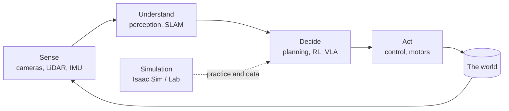

# Robotics & AI Bible

:::tip[The 30-second version]
This is a **lifelong handbook and dictionary** for AI and robotics: machine learning, deep learning, reinforcement learning, LLM / VLM / VLA, quantum computing, Physical AI, robotics, ROS 2, simulation and more. Use it to **look things up, learn, build, and prepare for interviews**. Every chapter is written in plain English first, with pictures, then in technical depth.
:::

## Find anything fast

| You want to… | Go to |
|---|---|
| Look up a word or abbreviation | [Dictionary A–Z](../glossary/index.md) (1,000+ terms), or press **Ctrl+K** to search everything |
| Learn a topic properly | the chapters in the sidebar (start with the 30-second box) |
| Answer interview questions | [Interview Q&A](../interview/question-bank.md) (hundreds of answered questions by domain) |
| Build a model, VLM or VLA | [Build It Yourself](../build-your-own/00-start-building.md) |
| Find a tool, dataset, paper or robot | [Reference directories](../reference/tools-libraries.md) |
| Refresh formulas or commands | [Cheat sheets](../cheatsheets/formulas.md) |

## How every page is built

Each page follows the same pattern so you always know where to look:

| Block | What it gives you | When to read it |
|---|---|---|
| 💡 **The 30-second version** | an everyday analogy and why it matters | always, first |
| 🖼️ **Pictures** | the idea at a glance | skim before the interview |
| 📖 **Sections** | plain explanation → the technical version | when you need depth |
| ➗ **"In words"** | every equation translated to a sentence | whenever a formula scares you |
| 🎯 **Interview Q&A** | a simple answer + the deeper follow-up | last 10 minutes of prep |

## Reading plans

| Time before interview | What to read |
|---|---|
| **1 hour** | [Question bank](../interview/question-bank.md), then the 30-second boxes of your role path |
| **1 day** | your role path below + [system design](../interview/system-design.md) |
| **1 week** | every page in your role path; redraw the figures from memory |
| **Always** | [story bank](../interview/behavioral.md) with your PhD and project stories |

## Want to build one yourself?

See **[★ Build It Yourself](../build-your-own/00-start-building.md)**: step-by-step guides (with tested code) to build an AI model, a VLM and a VLA, plus the shared evaluation, deployment and debugging toolkit.

## Role paths

| Target role | Read in this order |
|---|---|
| **Robot learning / Physical AI** | RL → Imitation learning → VLA → Isaac Lab → Sim-to-real → Manipulation |
| **Robotics software engineer** | C++ → ROS 2 → Nav2 / MoveIt → Control → Planning |
| **Perception / SLAM** | Geometry → Filters → SLAM → Localization → Sensors |
| **Humanoid / legged** | Dynamics → Whole-body control → Locomotion RL → Isaac Lab |
| **Manipulation / dexterity** | Kinematics → Grasping → MoveIt → Dexterous hands → Diffusion policy |
| **Quantum / research** | Quantum basics → Algorithms → VQE/QAOA → Quantum ML → Quantum robotics |
| **ML / LLM engineer** | ML → DL → Transformers → LLM training and serving → RAG and agents |

## The big picture

A robot that "does things by itself" is really a chain of ideas from this book. Read it left to right:

- **Sense + understand** → chapters 8–9 (sensors, filters, SLAM, vision)
- **Decide** → chapters 2–5, 7, 10 (ML, deep learning, RL, LLM/VLA, planning)
- **Act** → chapters 8, 10, 11 (kinematics, dynamics, control, walking, grasping)
- **Practise safely in a virtual world** → chapter 13 (simulation)
- **Glue it together** → chapter 12 (ROS 2, C++, Python)

## The 5-step recipe for answering any technical question

1. **Clarify.** What are the constraints? Real-time? Simulation or hardware?
2. **Say the idea in one plain sentence** before any math. (This is what the 💡 boxes train you to do.)
3. **Give the technical version.** The equation or the algorithm.
4. **Say what breaks.** Trade-offs and failure modes show real experience.
5. **Tie it to your own work.** "In my project on X, we saw…"

:::info Make it yours
Add a `## My experience` section at the bottom of any page with your own project examples and numbers. Interviewers remember stories, not definitions.
:::

## Honest note on accuracy

This book was written for interview preparation. Fast-moving details (Isaac Sim/Lab module names, ROS 2 distros, new model releases) change every few months, so check them against official docs before quoting version-specific facts.
