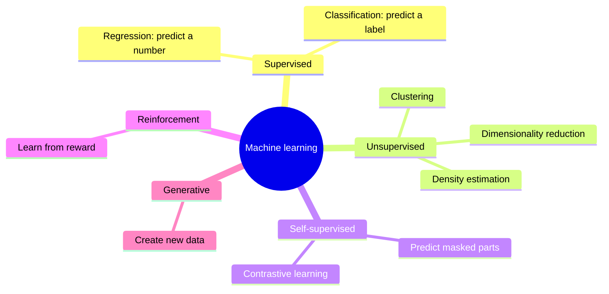

# Machine Learning Fundamentals

:::tip[The 30-second version]
Machine learning = **teaching a computer by examples instead of rules.** You don't write "if the pixels look like this, it's a cup". You show 10,000 labelled photos and let an algorithm find the pattern itself.
The three big flavours: **supervised** (examples with answers), **unsupervised** (find structure with no answers), **reinforcement** (learn from rewards by trial and error).
The central worry in all of ML: **does it work on data it has never seen?**
:::

## The three flavours

| Flavour | Analogy | Robot example |
|---|---|---|
| **Supervised** | a teacher marks your homework | "is this pixel a person?" from labelled images |
| **Unsupervised** | sorting a pile of unlabelled photos into piles | grouping lidar points into objects |
| **Self-supervised** | cover part of a sentence and guess it | pretraining vision models on unlabelled video |
| **Reinforcement** | training a dog with treats | learning to walk by trial and error |

## The one idea that matters most: generalisation

Imagine studying for an exam by memorising last year's answers. You'd ace *those* questions and fail new ones. That is **overfitting**. A model that is too simple to learn anything useful is **underfitting**.

*Same 14 data points. Left: a straight line is too rigid (high **bias**). Right: a wiggly curve chases noise (high **variance**). Middle is the sweet spot.*

$$ \text{Error} = \text{Bias}^2 + \text{Variance} + \text{Noise} $$

> **In words:** the mistakes of a model come from three sources: being too simple, being too jumpy, and randomness in the data you can't fix.

*While training, keep watching the validation loss. When it starts to rise while training loss keeps falling, you are memorising. Stop early.*

**How to fight overfitting:** more data, data augmentation, regularisation (L1/L2, dropout), early stopping, simpler model, ensembling.

**Data leakage (the silent killer):** information from the test set sneaks into training (e.g. normalising before splitting, shuffling time series, duplicate images in both sets). Your score looks great and the real-world result is bad.

## How to measure a model

*Left: ROC curve, closer to the top-left corner is better. Right: the four outcomes of any yes/no detector.*

| Metric | Plain meaning | Use it when |
|---|---|---|
| **Accuracy** | fraction correct | classes are balanced |
| **Precision** | of the things I flagged, how many were real? | false alarms are costly |
| **Recall** | of the real things, how many did I catch? | **misses are dangerous** (pedestrian detector) |
| **F1** | balance of precision and recall | single-number summary |
| **ROC-AUC / PR-AUC** | quality across all thresholds | comparing models; PR-AUC for rare events |
| **MSE / MAE** | average squared / absolute error | regression |
| **IoU / mAP** | overlap of predicted and true boxes | object detection |
| **Success rate ± CI** | did the robot finish the task? | robot policies (always report error bars) |

$$ \text{Precision}=\frac{TP}{TP+FP},\qquad \text{Recall}=\frac{TP}{TP+FN} $$

> **In words:** precision asks "when I shout *person*, am I right?"; recall asks "of all the real people, how many did I spot?"

## The classic algorithms, in one sentence each

*Different algorithms carve up the same data differently.*

| Algorithm | One-sentence idea | Strength | Weakness |
|---|---|---|---|
| **Linear / logistic regression** | draw the best straight line/plane | simple, interpretable | can't bend |
| **k-NN** | copy the label of your closest neighbours | no training | slow at runtime |
| **Naive Bayes** | multiply simple per-feature probabilities | works with tiny data | assumes independence |
| **SVM** | find the widest street between classes | strong on small data | slow on huge data |
| **Decision tree** | a flowchart of yes/no questions | readable | overfits |
| **Random forest** | vote of many randomised trees | robust | big |
| **Gradient boosting (XGBoost)** | each new tree fixes the previous trees' mistakes | **best on spreadsheets** | needs tuning |
| **k-means** | repeatedly move group centres to the middle of their points | simple | needs *k*, round clusters |
| **GMM + EM** | soft clusters as overlapping bells | gives probabilities | local optima |
| **PCA** | keep the directions with the most variation | compress, denoise | linear only |
| **Gaussian process** | a smooth function with built-in uncertainty | great uncertainty, small data | slow for big data |
| **HMM** | hidden state evolving over time | sequences | Markov assumption |

*k-means groups unlabelled points; PCA flattens 3-D data to 2-D while keeping most of its shape.*

**Bagging vs boosting:** bagging trains many models independently and averages them (cuts **variance**). Boosting trains models one after another, each correcting the last (cuts **bias**).

**EM algorithm in plain words:** guess which cluster each point belongs to (E-step), then re-fit the clusters to those guesses (M-step), repeat until stable.

## Practical workflow

1. **Look at the data** (plots, class balance, outliers). 2. **Split** train / validation / test (by time or by episode for robots). 3. **Baseline first** (a dumb model, so you know what "good" means). 4. **Scale features** if the model is distance- or gradient-based. 5. **Tune** on validation: grid → random → Bayesian (Optuna). 6. **Evaluate once** on the untouched test set. 7. **Monitor** for drift after deployment.

## Interview Q&A

**Explain bias vs variance.**
*Simply:* bias = too rigid to capture the pattern; variance = so flexible it memorises noise. *Fix:* high bias → bigger model/better features; high variance → more data, regularisation, bagging.

**Why standardise features?**
*Simply:* so a feature measured in thousands doesn't drown out one measured in decimals. *Deeper:* gradient and distance methods are scale-sensitive.

**Precision or recall for a pedestrian detector on a robot?**
*Simply:* recall, because a miss is a collision. *Deeper:* then reduce false alarms with temporal filtering and sensor fusion.

**Why does XGBoost often beat neural nets on tabular data?**
*Simply:* tables have mixed, irregular features and modest size, where trees shine. Nets shine on images, text and audio.

**What is calibration?**
*Simply:* when the model says 80 %, it should be right 80 % of the time. *Fix:* temperature scaling or isotonic regression.

**How do you cross-validate time-series data?**
*Simply:* never shuffle; always train on the past and test on the future (forward-chaining).
