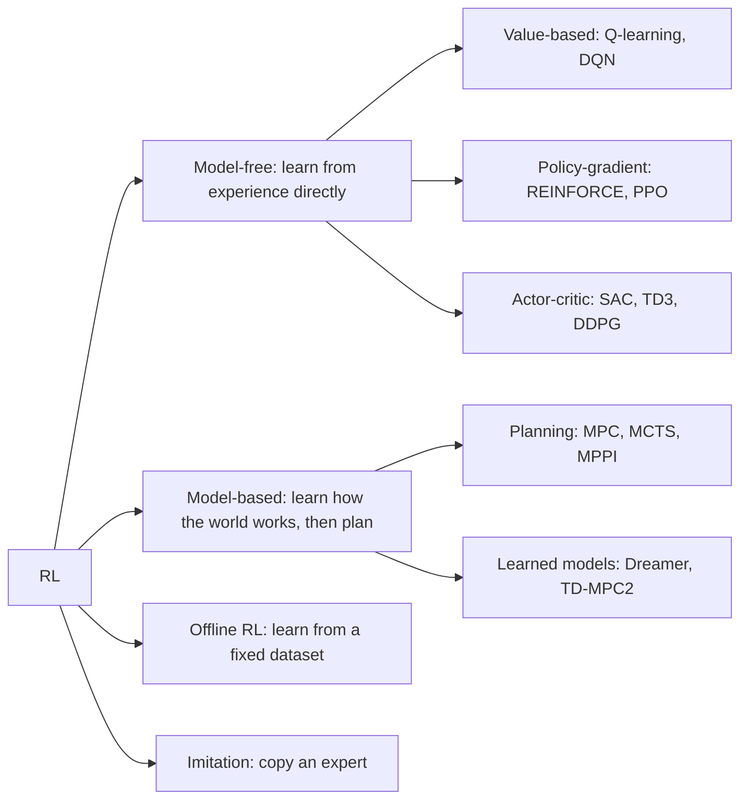

# Reinforcement Learning Foundations

:::tip[The 30-second version]
Reinforcement learning (RL) is **learning by trial and error with a score.** An agent tries actions, the world responds with a new situation and a reward, and over thousands of tries the agent discovers which actions lead to the most reward in the long run.
It's how robots learn to walk in simulation, how AlphaGo learned Go, and how chat models are tuned with human feedback.
:::

## 🎮 Try it yourself

Interactive: Q-learning<a href="/Robotics_bible/sim/qlearning.html" target="_blank">open full screen ↗</a>
<iframe src="/Robotics_bible/sim/qlearning.html" height="640" loading="lazy" title="Q-learning"></iframe>

## The loop

*The agent acts, the environment answers with a new state and a reward. Repeat.*

The vocabulary you need:

| Term | Plain meaning | Robot example |
|---|---|---|
| **State** $s$ | what the agent knows right now | joint angles, body tilt, camera image |
| **Action** $a$ | what it can do | target joint positions |
| **Reward** $r$ | immediate score | +1 for forward speed, −1 for falling |
| **Policy** $\pi(a\mid s)$ | the strategy: state → action | the neural network you are training |
| **Return** $G$ | total *future* reward (discounted) | how well the whole walk went |
| **Value** $V(s)$ | "how good is it to be here?" | being upright and moving is valuable |
| **Q-value** $Q(s,a)$ | "how good is this action here?" | |
| **Advantage** $A$ | "how much better than usual was this action?" | $Q - V$ |
| **Discount** $\gamma$ | how much you care about the future (0.9–0.99) | |

$$ G_t = r_{t+1}+\gamma r_{t+2}+\gamma^2 r_{t+3}+\dots $$

> **In words:** add up all future rewards, but count sooner rewards more than later ones.

A problem that fits this loop with the **Markov property** (the current state contains everything needed to decide) is an **MDP**. If the agent only sees part of the world (a camera, not the full state), it is a **POMDP** and needs memory (recurrent nets, history stacking).

## The Bellman idea: value is recursive

$$ V^\pi(s)=\mathbb E\big[\,r+\gamma V^\pi(s')\,\big] $$

> **In words:** "how good is this situation?" = "the reward I get now + how good the next situation is." That one sentence is the root of Q-learning, TD learning, actor-critic and more.

*A tiny world. After learning, every cell has a value (darker = better) and the arrows show the best move: toward the goal, around the pit.*

## The RL family tree

### Value-based (Q-learning, DQN)
Learn $Q(s,a)$ and always pick the best action. **DQN** adds a replay buffer and a target network to stabilise it. Great for discrete actions (games), awkward for continuous joint control.

### Policy gradient: directly improve the policy
Try actions; make the ones that did better than expected *more likely*.

$$ \nabla_\theta J = \mathbb E\big[\nabla_\theta\log\pi_\theta(a\mid s)\;A\big] $$

> **In words:** "increase the probability of actions in proportion to how much better than average they turned out."

**GAE** (generalised advantage estimation) mixes short and long lookahead to balance bias against variance.

### PPO: the workhorse of robot RL

*PPO clips how much a single update may change the policy. Good actions can only be made so much more likely; bad actions so much less. The shaded band is the "safe zone".*

$$ L = \mathbb E\big[\min\big(r_t A_t,\ \mathrm{clip}(r_t,1-\epsilon,1+\epsilon)A_t\big)\big],\quad r_t=\frac{\pi_\theta(a|s)}{\pi_{\text{old}}(a|s)} $$

> **In words:** improve the policy, but never let one update change its behaviour too much, because a crashed policy can't recover.

PPO + thousands of parallel simulated robots (Isaac Lab) = locomotion in minutes.

### Off-policy actor-critic (SAC, TD3)
Reuse old experience from a replay buffer, much more sample-efficient. **SAC** also rewards *randomness* (entropy), which improves exploration and robustness; it is the common choice when real-robot data is expensive.

| Algo | Idea | Use when |
|---|---|---|
| **PPO** | clipped policy gradient, on-policy | massive parallel sim (Isaac Lab, legged robots) |
| **SAC** | max reward + entropy, off-policy | data is expensive (real-world RL) |
| **TD3 / DDPG** | deterministic actor + Q critic | continuous control, simpler |
| **DQN family** | learn Q for discrete actions | games, discrete decisions |
| **Dreamer / TD-MPC2** | learn a world model, plan inside it | sample efficiency |

## Making RL actually work

**Exploration:** ε-greedy, entropy bonuses, curiosity (reward novelty), parameter noise.
**Reward design:** the hardest part. Sparse (only at the goal) is hard to learn from; dense (shaped) is easier but can be *hacked* (the robot finds a loophole). Use potential-based shaping, curriculum, and sanity-check videos.
**Model-based RL:** learn $P(s'|s,a)$, then plan (MPC, MCTS) or "dream" rollouts. Efficient, but errors in the model get exploited.
**Offline RL and imitation:** learn from logged data. Danger: distribution shift (the policy tries actions never seen in data). Remedies: **CQL**, **IQL**, BC regularisation. See [Imitation learning](../07-physical-ai/imitation-robot-learning.md).
**RLHF family (bridge to LLMs):** train a reward model from human preferences, then optimise with PPO; **DPO** skips the reward model; **GRPO** compares a group of answers and needs no critic.
**Special topics:** multi-agent (MAPPO, QMIX), hierarchical RL (options, skills), safe RL (constraints, CBFs), meta-RL.

## Interview Q&A

**On-policy vs off-policy?**
*Simply:* on-policy learns only from fresh experience of the current policy (PPO: stable, data-hungry); off-policy can reuse old experience (SAC: efficient, fiddlier).

**Why does PPO clip?**
*Simply:* to stop one over-eager update from wrecking the policy. *Deeper:* it is a cheap stand-in for a trust-region constraint.

**Why use an advantage instead of the raw return?**
*Simply:* subtract a baseline so the signal says "better or worse than usual" rather than "big or small". Same expected gradient, much less noise.

**What is the deadly triad?**
*Simply:* function approximation + bootstrapping + off-policy data can diverge.

**SAC or PPO for a robot?**
*Simply:* SAC when each real sample is costly; PPO when you can simulate thousands of robots in parallel.

**How do you debug RL?**
*Simply:* check reward scale, observation normalisation, episode termination (time-out vs failure!), seeds; test on a trivial task; log entropy, KL, value-explained-variance; **watch videos**.
