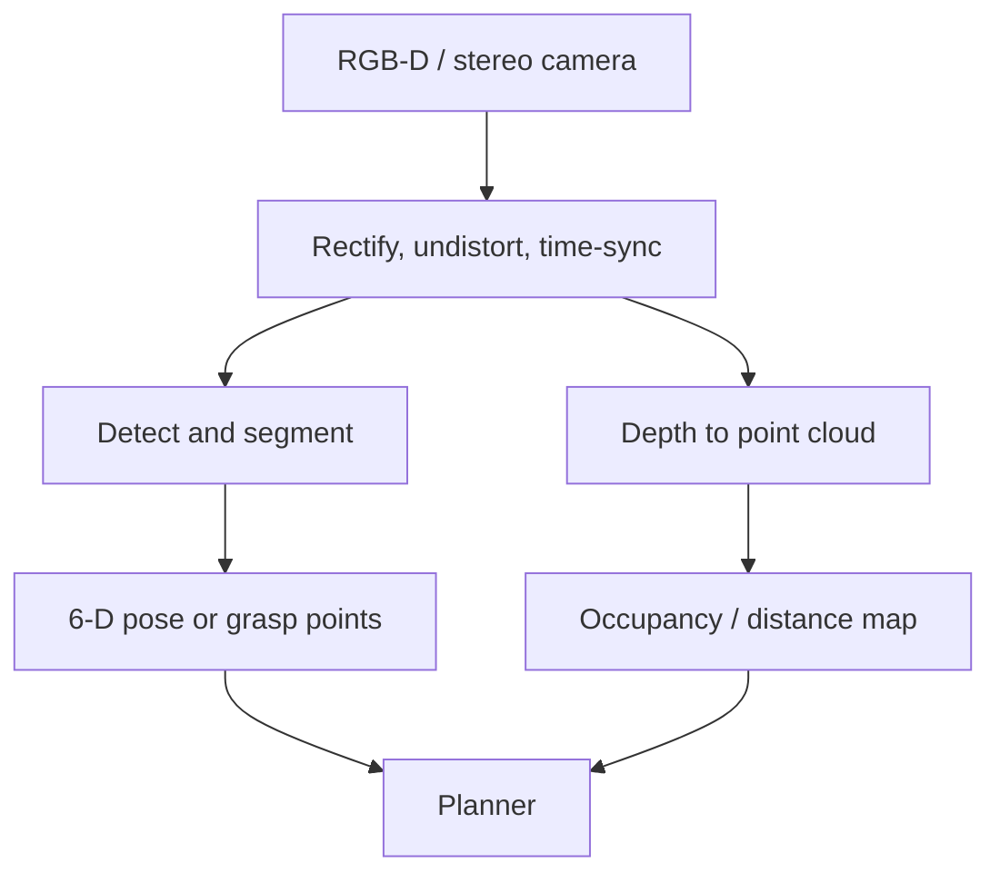

# Robot Perception

:::tip[The 30-second version]
Perception turns raw sensor data (pixels, laser points) into something the robot can *use*: "there's a mug **here**, its handle faces **left**, and the table is **0.4 m** below it." Modern perception = a **foundation model** (SAM, DINOv2, CLIP, Depth Anything) plus a bit of **geometry** to get exact 3-D positions.
:::

## 🎮 Try it yourself

Interactive: Pinhole camera<a href="/Robotics_bible/sim/camera.html" target="_blank">open full screen ↗</a>
<iframe src="/Robotics_bible/sim/camera.html" height="520" loading="lazy" title="Pinhole camera"></iframe>

## The perception menu

| Task | What it answers | Go-to tools |
|---|---|---|
| **Detection** | what and where (boxes) | YOLO family, RT-DETR; open-vocabulary: GroundingDINO, OWLv2 |
| **Segmentation** | which pixels belong to the object | **SAM / SAM 2**, Mask2Former |
| **Depth** | how far is each pixel | stereo, RGB-D, Depth Anything v2, Metric3D |
| **Tracking / flow** | how things move | RAFT, CoTracker, ByteTrack, SAM 2 video |
| **6-D object pose** | exact position + orientation of a known object | FoundationPose, MegaPose, DenseFusion |
| **Keypoints / affordances** | where to grasp / push / open | DINOv2 features, VRB |
| **3-D detection** | boxes in 3-D | PointPillars, CenterPoint, BEVFusion |
| **Scene reconstruction** | full 3-D model | TSDF, NeRF, 3D Gaussian Splatting, COLMAP |
| **Humans** | pose, hands | MediaPipe, HaMeR |
| **Grasp perception** | where can I grip it | Contact-GraspNet, AnyGrasp, GraspGen |

## A typical pipeline

**From pixel to 3-D point:** with depth $Z$ and camera intrinsics, $X=(u-c_x)Z/f_x$, $Y=(v-c_y)Z/f_y$.

> **In words:** "undo the camera's projection: a pixel plus its distance gives a point in space."

**Point-cloud clean-up:** voxel down-sampling, remove outliers, RANSAC plane fitting (find the table), Euclidean clustering (separate objects).

## Putting models on a robot
- Optimise with **TensorRT / ONNX**, FP16 or INT8, batching.
- **Isaac ROS** provides GPU-accelerated nodes (NITROS zero-copy) for stereo depth, detection, VSLAM, nvblox, pose estimation.
- Budget latency end to end (camera → decision) and timestamp everything for TF.
- Monitor confidence and detect **out-of-distribution** inputs; fall back to safe behaviour.

## Making perception robust
Lighting and texture changes, **transparent and reflective objects** (hard for depth: use stereo or learned depth completion), motion blur, occlusion, long-tail objects. Tools: augmentation, domain randomisation, ensembles / MC dropout / conformal prediction for **uncertainty**, test-time adaptation.

## Datasets
COCO, LVIS, ImageNet, KITTI, nuScenes, Waymo, ScanNet, YCB-Video, BOP (6-D pose), Objaverse, EPIC-Kitchens, Ego4D.

## Interview Q&A

**What are IoU and mAP?**
*Simply:* IoU = overlap of predicted and true box ÷ their union. mAP = average precision across classes (and IoU thresholds).

**What does non-maximum suppression do?**
*Simply:* removes duplicate boxes on the same object, keeping the highest-scoring one. DETR avoids it with set prediction.

**Why is SAM useful in robotics?**
*Simply:* give it a click or a box and it cuts out any object zero-shot, great for grasp targets and auto-labelling.

**Stereo vs time-of-flight depth?**
*Simply:* stereo is passive and long-range but needs texture; ToF is active and dense but struggles with sunlight and shiny surfaces.

**How do you get an object's 6-D pose from one RGB-D image?**
*Simply:* segment it, then match to its 3-D model (render-and-compare like FoundationPose), refine with ICP.
