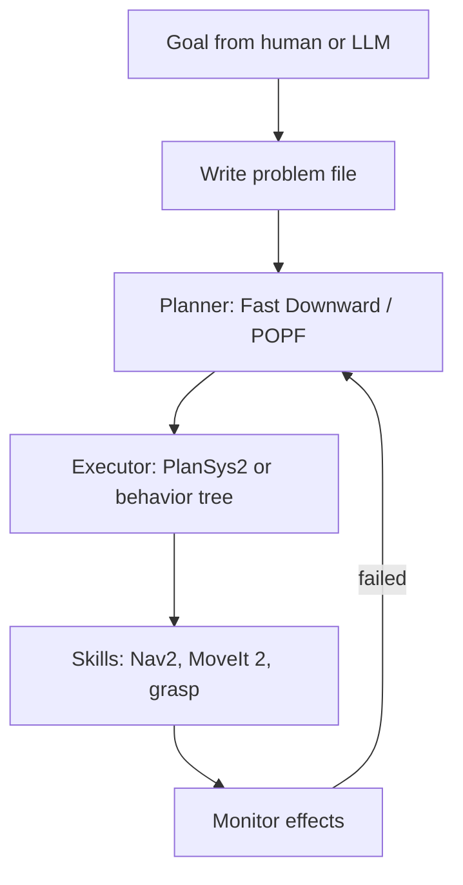

# Task Planning & PDDL

:::tip[The 30-second version]
**Motion planning** answers "how do I move my arm without hitting things?". **Task planning** answers the level above: "what *sequence of actions* achieves the goal?" (go to the kitchen → pick the cup → go to the table → place it).
You describe the world with **facts** and the actions with **preconditions** and **effects**; a planner searches for a sequence that turns the starting facts into the goal facts. The standard language is **PDDL**.
:::

## How a symbolic planner thinks

- **State** = a set of true facts, e.g. `(at robot kitchen)`, `(hand-empty robot)`.
- **Action** = needs some facts to be true (*precondition*) and changes some (*effect*).
- **Goal** = facts you want true at the end.
- **Search** = find an action sequence from start to goal. Fast planners use heuristics from *delete relaxation* (pretend actions never remove facts) to guess how far the goal is: Fast Downward (LAMA), FF, OPTIC, POPF.

## PDDL: domain and problem

PDDL splits the model in two files: the **domain** (the rules: types, predicates, actions) and the **problem** (this particular situation: objects, initial facts, goal).

```lisp
;; domain.pddl : the rules of the world
(define (domain pick-place)
  (:requirements :strips :typing :negative-preconditions)
  (:types robot location obj)
  (:predicates
    (at ?r - robot ?l - location)
    (obj-at ?o - obj ?l - location)
    (holding ?r - robot ?o - obj)
    (hand-empty ?r - robot)
    (connected ?a ?b - location))

  (:action move
    :parameters (?r - robot ?from ?to - location)
    :precondition (and (at ?r ?from) (connected ?from ?to))
    :effect (and (not (at ?r ?from)) (at ?r ?to)))

  (:action pick
    :parameters (?r - robot ?o - obj ?l - location)
    :precondition (and (at ?r ?l) (obj-at ?o ?l) (hand-empty ?r))
    :effect (and (holding ?r ?o) (not (obj-at ?o ?l)) (not (hand-empty ?r))))

  (:action place
    :parameters (?r - robot ?o - obj ?l - location)
    :precondition (and (at ?r ?l) (holding ?r ?o))
    :effect (and (obj-at ?o ?l) (hand-empty ?r) (not (holding ?r ?o)))))
```

```lisp
;; problem.pddl : one concrete situation
(define (problem deliver-box)
  (:domain pick-place)
  (:objects r1 - robot a b c - location box - obj)
  (:init (at r1 a) (obj-at box b) (hand-empty r1)
         (connected a b) (connected b a) (connected b c) (connected c b))
  (:goal (obj-at box c)))
```

Run: `fast-downward.py domain.pddl problem.pddl --search "astar(lmcut())"`
Plan found: `move r1 a b → pick r1 box b → move r1 b c → place r1 box c`.

### PDDL versions and features (be able to list these)
- **STRIPS / ADL:** types, negative preconditions, conditional effects, `forall`/`exists`.
- **PDDL 2.1:** numeric fluents and **durative actions** (`at start / over all / at end`) for time.
- **2.2:** derived predicates and timed initial literals. **3.0:** preferences and trajectory constraints. **PDDL+:** continuous processes.
- **Related:** HTN / HDDL (hierarchical tasks), PPDDL/RDDL (probabilistic), FOND (non-deterministic), **PDDLStream** (continuous sampling for TAMP).

**Common modelling mistakes:** forgetting to delete old facts (frame problem), symmetrical objects causing blow-up, unreachable goals from a missing precondition, grounding explosion (too many objects).

## From plan to robot



**PlanSys2** (ROS 2) provides a problem expert, a planner (POPF), an executor, and action performers in behavior trees.

## Behavior trees (BTs)


*A tree ticked ten times a second. Sequence = do everything in order; Fallback = try until one works; leaves are actions and checks.*

Nodes return **SUCCESS / FAILURE / RUNNING**. Control nodes: **Sequence** (AND), **Fallback/Selector** (OR), **Parallel**, and decorators (Retry, Timeout, Inverter). A shared **blackboard** passes data.

| | **Behavior tree** | **Finite-state machine** |
|---|---|---|
| Structure | hierarchy of reusable pieces | states + transitions |
| Growth | scales well | transitions explode (N² arrows) |
| Reactivity | re-checks conditions each tick | needs explicit transitions |
| Libraries | **BehaviorTree.CPP** (Nav2, Groot2), py_trees | SMACH, FlexBE, YASMIN |

```xml
<root BTCPP_format="4"><BehaviorTree ID="Main">
  <Sequence>
    <Action ID="NavigateTo" goal="{pick_pose}"/>
    <Fallback>
      <Action ID="Grasp"/>
      <RetryUntilSuccessful num_attempts="3"><Action ID="RegraspWithNewView"/></RetryUntilSuccessful>
    </Fallback>
    <Action ID="NavigateTo" goal="{place_pose}"/>
    <Action ID="Place"/>
  </Sequence>
</BehaviorTree></root>
```

## LLMs and planning
- **LLM as translator:** natural language → PDDL (**LLM+P**), checked by a planner and validator (VAL).
- **LLM as planner:** SayCan, Inner Monologue, Code-as-Policies, ProgPrompt.
- **Failure modes:** invented objects, missing preconditions, poor long-horizon consistency. **Safe pattern:** LLM proposes → symbolic/simulation check verifies → robot executes.

## Interview Q&A

**STRIPS vs PDDL?**
*Simply:* PDDL is a standard language that grew out of STRIPS, adding types, richer conditions, numbers and time.

**Why do planners use delete relaxation?**
*Simply:* ignoring "undo" effects makes a much easier problem whose answer is a good guess of the true distance to the goal.

**Behavior tree vs FSM?**
*Simply:* BTs are modular and reusable, with no explosion of transitions, and they re-evaluate conditions every tick.

**How do you recover from a failed action?**
*Simply:* monitor effects, update the world model, replan; use BT fallbacks for expected failures; escalate to a human otherwise.

**Why combine task and motion planning?**
*Simply:* a plan can be logically fine but geometrically impossible (can't reach the shelf). Motion planning checks feasibility and fills in the continuous details.
