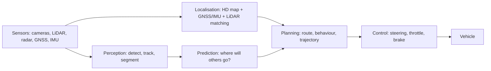

# Autonomous Driving and Drones

:::tip[The 30-second version]
A self-driving car and a drone are both "mobile robots with a lot at stake": they must **sense** the world, **predict** what others will do, **plan** a safe path, and **control** the vehicle, all in real time. Cars live on constrained roads with traffic rules; drones fly freely in 3-D but are underactuated and fragile. The building blocks are the same ones used throughout this Bible.
:::

## 1. Autonomous driving

### Levels of automation (SAE)
| Level | Meaning |
|---|---|
| **L0** | no automation |
| **L1** | driver assistance (adaptive cruise or lane keeping) |
| **L2** | combined assistance; driver must supervise |
| **L3** | system drives in limited conditions; driver takes over on request |
| **L4** | no driver needed within a defined operational design domain (ODD) |
| **L5** | drives anywhere a human can |

### The classic modular stack


| Module | What it does | Typical methods |
|---|---|---|
| **Perception** | find vehicles, pedestrians, lanes, signs, free space | multi-camera BEV models (BEVFormer, BEVFusion), LiDAR detectors (PointPillars, CenterPoint), radar fusion, tracking |
| **Localisation** | centimetre-level pose in a map | GNSS-RTK + IMU + LiDAR/vision matching to HD maps |
| **Prediction** | forecast other agents' trajectories | learned multi-modal predictors (transformers, graph networks) |
| **Planning** | route → behaviour (lane change, yield) → trajectory | lattice/graph search, optimisation, MPC, learned planners |
| **Control** | track the trajectory | Stanley/pure pursuit, MPC with bicycle model, PID for speed |
| **Safety layer** | enforce rules and limits | rule-based monitors, responsibility-sensitive safety, ISO 26262 / SOTIF |

### End-to-end driving
A single network maps sensor input to a plan or controls (UniAD, imitation from fleet data, VLA-style driving models). Advantages: less hand-engineering, scales with data. Challenges: interpretability, rare events, verification. Many systems are **hybrid** (learned planner + rule-based safety).

### Data and simulation
Fleet data collection, auto-labelling, scenario mining, closed-loop simulation (CARLA, internal simulators, world models), shadow mode, and large-scale evaluation of rare scenarios.

### Open stacks
**Autoware** (ROS 2), **openpilot**, **Apollo**; datasets: KITTI, nuScenes, Waymo Open, Argoverse.

## 2. Drones (UAVs)

### Types
| Type | Notes |
|---|---|
| **Multirotor (quadrotor, hexarotor)** | hover, agile, short endurance |
| **Fixed-wing** | efficient long range, cannot hover |
| **VTOL hybrids** | take off like a multirotor, cruise like a plane |
| **Helicopters / flapping wing** | special cases |

### Quadrotor dynamics in brief
- Four propellers produce a total thrust along the body z-axis and torques about the three axes.
- The system is **underactuated** (4 inputs, 6 DoF) but **differentially flat** in position and yaw, so smooth trajectories can be planned in position/yaw and converted to commands.
- $m\ddot p=-mg\,e_3+R\,f\,e_3$ (translation), $J\dot\omega=\tau-\omega\times J\omega$ (rotation).

### Control stack (PX4 / ArduPilot style)
```
position setpoint → position PID → desired acceleration/attitude → attitude controller → body-rate PID → motor mixer → ESCs/motors
```
Inner loops run at hundreds of Hz to kHz. Advanced controllers: geometric control on SO(3), MPC, learned policies (drone racing with RL).

### Estimation
EKF fusing IMU, GNSS, barometer, magnetometer, optical flow/rangefinder; indoors/GNSS-denied: **visual-inertial odometry**, LiDAR odometry, UWB.

### Planning and autonomy
Minimum-snap trajectory optimisation, ESDF-based local planners (EGO-Planner), exploration (frontier-based), obstacle avoidance from depth, mission planning (waypoints, coverage), swarms.

### Practical considerations
Battery and payload trade-offs, wind, vibration isolation for sensors, propeller and motor selection, regulations (geofencing, remote ID), safety (failsafes: return-to-home, land, parachute), simulation (Gazebo/PX4 SITL, AirSim, Isaac Sim with Pegasus).

## 3. Comparison

| | Car | Drone |
|---|---|---|
| Space | 2-D roads | 3-D free space |
| Constraint | non-holonomic, traffic rules | underactuated, flat outputs |
| Control rate | 10–100 Hz | 250 Hz–8 kHz inner loops |
| Safety | ISO 26262, SOTIF, ODD | aviation rules, geofencing, failsafes |
| Localisation | HD map + GNSS/LiDAR | GNSS/VIO/optical flow |

## Interview Q&A

**What does differential flatness mean for quadrotors?**
*Simply:* you can plan a smooth position and yaw path and compute the needed thrust and attitude from its derivatives. *Deeper:* minimum-snap polynomials give feasible trajectories.

**Modular versus end-to-end driving?**
*Simply:* modular is explainable but needs hand-built interfaces; end-to-end learns the whole mapping but is harder to verify. *Deeper:* hybrids with safety layers are common.

**What is an ODD?**
*Simply:* the conditions the system is designed to handle. *Deeper:* road types, weather, speeds, time of day; defines safety validation scope.

**Why BEV representations?**
*Simply:* a top-down map is a convenient common space for multi-camera and LiDAR fusion and planning.

**How does a quadrotor control attitude?**
*Simply:* nested loops: attitude error → desired body rates → motor commands. *Deeper:* rate loop at ~1 kHz; motor mixer converts thrust and torques to four motor speeds.

**How do you localise a drone indoors?**
*Simply:* visual-inertial odometry or LiDAR odometry. *Deeper:* EKF/optimisation fusing camera and IMU; optical flow and a range sensor for velocity and height.
