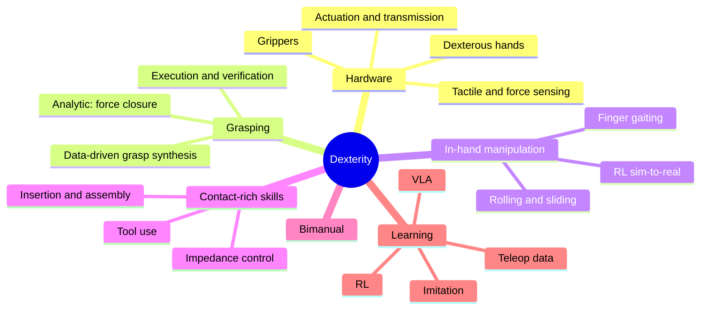

# Manipulation & Dexterity

:::tip[The 30-second version]
**Manipulation** = using the robot's hands to change the world (pick, place, push, pour, assemble). **Dexterity** = doing it *skilfully*: re-orienting an object in your fingers, using tools, working with two hands, handling delicate contact.
It is hard because the robot must **see** the object, **plan** a reachable collision-free motion, **feel** contact, and **control forces**, all in one loop, with an imperfect model of friction and shape.
:::

## The dexterity breakdown (what an interviewer expects you to organise)

## Hardware

| Type | Examples | Notes |
|---|---|---|
| **Parallel-jaw gripper** | Robotiq 2F, Franka hand | robust, most of industry |
| **Suction** | Schmalz, Piab | warehouse picking of flat items |
| **Soft / underactuated** | SoftHand, Fin-Ray, Robotiq 3F | adapts passively to shape |
| **Anthropomorphic hands** | Shadow (20 DoF), Allegro (16), **LEAP Hand**, Inspire, Optimus/Figure hands | many degrees of freedom; reliability and cost are the challenges |

Design trade-offs: DoF vs complexity, tendon vs direct drive, fingertip softness (rubber adds friction), tactile coverage, thumb opposition (the thumb gives ~40 % of human hand function).

## Grasp theory in plain English

*Left: a fingertip only holds if its push stays inside the friction cone, otherwise it slips. Right: two opposite fingertips (an antipodal pinch) can hold an object using friction.*

- **Contact models:** point contact, contact with friction (cone $\|f_t\|\le\mu f_n$), soft-finger (adds torsional friction).
- **Force closure:** the contacts can resist any push or twist using friction. **Form closure:** the object is trapped by geometry alone.
- **Grasp matrix:** $w = G f$ maps finger forces $f$ to the net force and torque (wrench) on the object.
- **Quality score (Ferrari–Canny):** how large a disturbance the grasp can withstand.

## Finding grasps

| Approach | Examples |
|---|---|
| **Analytic** | GraspIt!, Dex-Net (GQ-CNN) |
| **Deep 6-DoF** | Contact-GraspNet, AnyGrasp, GraspNet-1B, GraspGen |
| **Language-conditioned** | LERF-TOGO, GraspGPT |
| **Execution** | pre-grasp approach → compliant closing → lift test → regrasp if slipping |

Transparent and reflective objects confuse depth sensors; use stereo, learned depth completion, or tactile.

## In-hand manipulation and contact-rich skills

- **In-hand:** finger gaiting, rolling, sliding. Best results come from **RL in simulation with domain randomization** (OpenAI Dactyl, Isaac Gym AllegroHand, **DeXtreme**), with proprioceptive/tactile feedback and teacher–student training.
- **Contact-rich:** peg-in-hole, assembly (Isaac Factory, IndustReal), cables, cloth, liquids, tool use. Ingredients: **impedance/admittance control**, force thresholds, spiral search, learning residual policies on top of compliance, tactile slip detection.
- **Bimanual / mobile / humanoid:** ALOHA and Mobile ALOHA with ACT/diffusion policies; closed-chain constraints; loco-manipulation.

## How learning fits in
1. **Data:** teleop (gloves, VR, exoskeleton, GELLO), human video retargeting, simulation. 2. **Policy:** diffusion policy / ACT / VLA with action chunking. 3. **Improve:** RL fine-tuning (HIL-SERL). 4. **Safety layer:** force and impedance limits. 5. **Evaluate:** ≥ 50 trials per task, report failure types.
**Benchmarks:** YCB objects, Dex-Net, GraspNet-1B, ManiSkill3, RLBench, LIBERO, Meta-World, robosuite, RoboCasa, BEHAVIOR-1K, Factory, NIST assembly boards.

## Interview Q&A

**Force closure vs form closure?**
*Simply:* form closure traps the object geometrically; force closure uses friction to resist any disturbance.

**Why is in-hand manipulation hard to learn?**
*Simply:* many joints, switching contacts, sparse reward, simulation never matches real contact exactly, and the object is partly hidden by the fingers.

**Why tactile sensing?**
*Simply:* cameras can't see through the fingers; touch tells you where contact is, how hard, and when the object slips.

**Underactuated hands: pros and cons?**
*Simply:* simple and adaptive, but less precise and harder to model.

**Design a bin-picking system.**
*Simply:* RGB-D perception → segmentation → grasp proposals → collision-free approach (MoveIt/cuRobo) → force-aware close and lift check → place → retries and human-assist exceptions. Track picks/hour and success rate.

**What makes insertion hard?**
*Simply:* the clearance is smaller than the position uncertainty, so you need compliance, search, force feedback, or learned skills.
