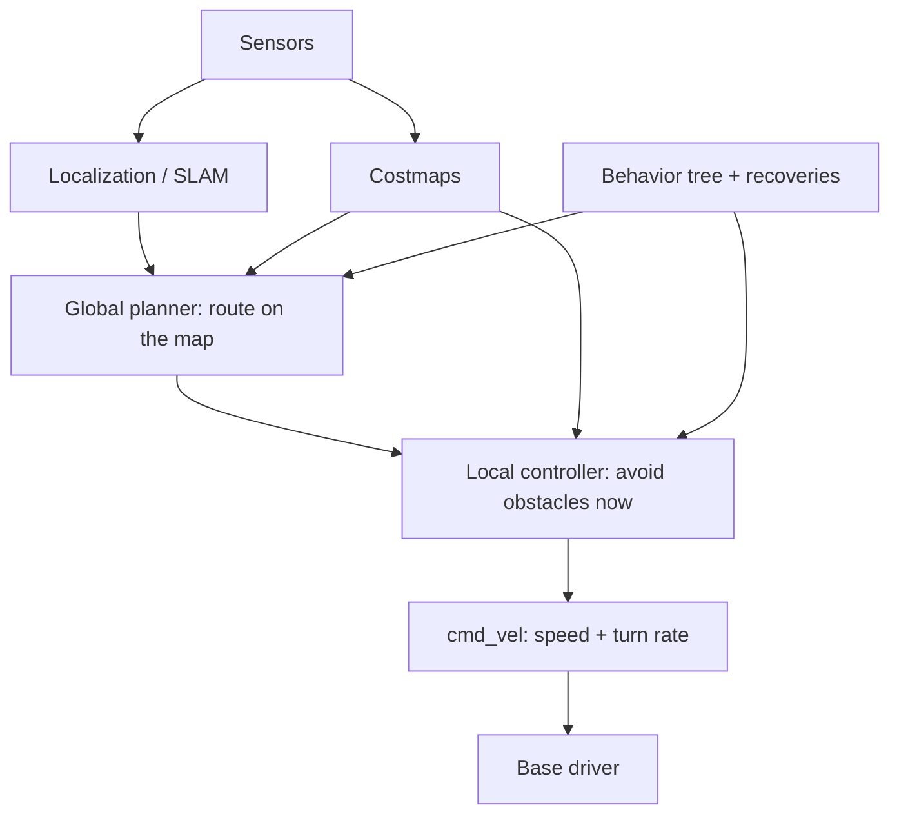

# Mobility

:::tip[The 30-second version]
**Mobility** = how the robot's body gets around: wheels, legs, rotors, tracks, fins. Whatever the body, a navigating robot needs the same loop: **know where you are → decide where to go → avoid things → move the motors**. The details change with the body.
:::

## 🎮 Try it yourself

Interactive: Odometry drift<a href="/Robotics_bible/sim/diff-drive.html" target="_blank">open full screen ↗</a>
<iframe src="/Robotics_bible/sim/diff-drive.html" height="560" loading="lazy" title="Odometry drift"></iframe>

Interactive: Pure pursuit tracking<a href="/Robotics_bible/sim/pure-pursuit.html" target="_blank">open full screen ↗</a>
<iframe src="/Robotics_bible/sim/pure-pursuit.html" height="540" loading="lazy" title="Pure pursuit tracking"></iframe>

## Ways to move

| Modality | Examples | Key challenge |
|---|---|---|
| **Wheeled** (diff-drive, car-like, skid-steer, omni/mecanum, swerve) | warehouse AMRs, cars | slip, non-holonomic limits |
| **Tracked** | rescue and military | skid steering on rough terrain |
| **Legged** | quadrupeds, humanoids | balance and contact scheduling → [Legged](./legged-locomotion.md) |
| **Aerial** | quadrotors, VTOL | under-actuation, wind, battery |
| **Aquatic** | AUV / ROV | comms, buoyancy |
| **Space** | free-flyers, rovers | microgravity, comms delay |
| **Hybrid** | wheel-legged, climbing | mode switching |

*A differential-drive robot gets all its motion from the difference between two wheel speeds. It cannot slide sideways (a "non-holonomic" constraint).*

## The navigation pipeline

**Why two planners?** The **global planner** finds the whole route on the known map (slow, far-sighted). The **local controller** reacts to what the sensors see right now (fast, short-sighted).

### Local controllers
| Controller | Plain idea |
|---|---|
| **Pure pursuit** | steer toward a point a bit ahead on the path |
| **Stanley** | correct both sideways offset and heading |
| **Regulated Pure Pursuit** (Nav2) | slow down near obstacles and in sharp turns |
| **DWA** | try many (speed, turn) pairs, simulate, score |
| **TEB** | elastic band of poses over time |
| **MPC / MPPI** | sample or optimise many trajectories, pick the cheapest |
| **Social navigation** | predict people and keep personal space |

### Costmap and frames
**Costmap** layers: static map + obstacles + inflation (padding by the robot's size) + keep-out zones. **Frames:** `map → odom → base_link → sensors`. `odom` is smooth but drifts; `map → odom` jumps when localisation corrects (ROS REP-105).

## Mobile manipulation
Base + arm together (Stretch, Spot-arm, TIAGo, Mobile ALOHA). Plan where to park the base so the arm can reach ("inverse reachability"), and fix the small base error with vision or fiducials before a precise grasp.

## Drones in brief
The quadrotor is **differentially flat**: plan a smooth position/yaw path (minimum-snap) and the rotor commands follow. Control is cascaded: position → attitude → rate → motor mix (PX4, ArduPilot). Estimation: EKF (IMU + GNSS + barometer + optical flow, or VIO indoors). Racing drones now use time-optimal planning and RL.

## Safety and fleets
Watchdogs, safety-rated LiDAR zones, speed limits near people, cliff detection, geofences, e-stop, degraded modes, diagnostics. Fleets: **Open-RMF**, VDA5050, traffic management, elevators/doors, map versioning, OTA updates.

## Interview Q&A

**What is a non-holonomic constraint?**
*Simply:* the robot can't move in some directions instantaneously (a car can't slide sideways), though it can still reach any pose by manoeuvring.

**Why separate global and local planning?**
*Simply:* global gives the long-range plan on a static map; local deals with surprises at high rate.

**What are recovery behaviours?**
*Simply:* what the robot does when stuck: clear the costmap, spin, back up, wait, ask for help.

**Sources of odometry error?**
*Simply:* wheel slip, wrong wheel size or track width, encoder resolution; fuse with IMU and visual/LiDAR odometry.

**Why inflate the costmap?**
*Simply:* turns "does the robot's body hit something?" into "is this one cell too close?", which is a fast check.
