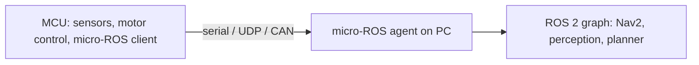

# Embedded Systems and Real-Time Software

:::tip[The 30-second version]
Robots run code at two speeds. **Real-time** code (motor control, safety, estimation) must finish **on schedule every time**, so it runs on microcontrollers or specially configured Linux. **Non-real-time** code (perception, planning, AI) runs on a PC or GPU. Knowing where the line is, and how the two talk, is core robotics engineering.
:::

## 1. What "real-time" means

| Term | Meaning |
|---|---|
| **Hard real-time** | missing a deadline is a failure (motor current loop, airbag) |
| **Soft real-time** | missing occasionally degrades quality (video, planner) |
| **Latency** | delay from input to output |
| **Jitter** | variation in that delay; the enemy of control loops |
| **Determinism** | same timing every time |
| **Worst-case execution time (WCET)** | the longest a task can take; what you must bound |

**Rule of thumb:** a control loop at rate $f$ must complete well within $1/f$; sensor-to-actuator latency eats into the stability margin.

## 2. Microcontrollers (MCUs)

| Family | Notes |
|---|---|
| **STM32 (ARM Cortex-M)** | industry standard; HAL/LL libraries; CAN, SPI, timers |
| **ESP32** | Wi-Fi/Bluetooth; hobby and IoT |
| **Teensy / RP2040 / Arduino** | easy prototyping |
| **TI C2000 / Infineon** | motor-control specialists |

Typical MCU tasks: read encoders and current sensors, run the **FOC current loop** (10–40 kHz), PWM generation, CAN/EtherCAT communication, safety monitoring.

### Peripherals to know
GPIO, timers/PWM, ADC, DMA (move data without CPU), interrupts, UART/SPI/I²C/CAN, watchdog timers.

### Firmware patterns
- **Superloop + interrupts** (simple), **RTOS tasks** (FreeRTOS, Zephyr) with priorities, queues and mutexes.
- **Interrupt service routines** must be short; defer work to tasks.
- **Fixed-point maths** on MCUs without an FPU; check overflow.
- **Bootloader and safe update**, watchdog resets, brown-out detection.

## 3. Real-time operating systems (RTOS)

| RTOS | Notes |
|---|---|
| **FreeRTOS** | widely used, small |
| **Zephyr** | modern, many boards, good drivers |
| **RTEMS / VxWorks / QNX** | space, aerospace, automotive, industrial |
| **ThreadX / embOS** | commercial |

Scheduling basics: **fixed priority preemptive** scheduling; **rate-monotonic** assigns higher priority to shorter periods; avoid **priority inversion** with priority inheritance; keep critical sections short.

## 4. Real-time Linux for robot computers

| Technique | Why |
|---|---|
| **PREEMPT_RT kernel** | makes the kernel fully preemptible for bounded latency |
| **`SCHED_FIFO` priority threads** | deterministic scheduling of the control thread |
| **CPU isolation / pinning (`isolcpus`, affinity)** | keep other tasks off the control core |
| **`mlockall` and pre-faulting memory** | avoid page faults |
| **No `malloc`, locks or I/O in the loop** | unbounded latency sources |
| **Disable power saving / frequency scaling** | stable timing |
| **Measure with `cyclictest`** | verify worst-case latency under load |

`ros2_control` follows this pattern: a real-time controller manager loop at e.g. 1 kHz with hardware interfaces, separate from non-RT nodes.

## 5. micro-ROS and bridging the two worlds

**micro-ROS** brings ROS 2 concepts (publishers, subscribers, services, parameters) to microcontrollers through the Micro XRCE-DDS protocol and a **micro-ROS agent** on the PC.

Alternatives: a custom serial protocol, **EtherCAT** master on the PC controlling drives directly, CAN-based protocols (CANopen).

## 6. Communication buses

| Bus | Speed / traits | Typical use |
|---|---|---|
| **UART** | simple point-to-point | debug, GPS |
| **I²C** | 100 kHz–1 MHz, 2 wires | low-speed sensors |
| **SPI** | up to tens of MHz | IMUs, encoders, memory |
| **CAN / CAN-FD** | robust differential bus, multi-node | motor drivers, vehicles |
| **EtherCAT** | deterministic, ~1 kHz+, distributed clocks | multi-axis robots |
| **RS-485 / Modbus** | long, noisy cable runs | industrial sensors |
| **Ethernet / TSN** | high bandwidth, time-sensitive extensions | cameras, LiDAR, fleet |
| **USB / MIPI CSI / GigE Vision** | camera interfaces | vision |

## 7. Time and synchronisation
Hardware timestamps, **PTP** (IEEE 1588) or GPS-disciplined clocks, camera/IMU hardware triggers, and compensating latency in estimation. Bad time sync is a top cause of fusion errors.

## 8. Testing embedded and real-time code
Unit tests on host (hardware abstraction layer mocked), **hardware-in-the-loop** benches, logic analyser/oscilloscope for timing, fault injection, static analysis (MISRA C rules), and watchdog/brown-out tests.

## Interview Q&A

**Hard versus soft real-time?**
*Simply:* hard must never miss a deadline; soft can miss occasionally. *Deeper:* motor current loops are hard real-time; planning is soft.

**How do you make Linux real-time?**
*Simply:* PREEMPT_RT, SCHED_FIFO, CPU pinning, memory locking, no allocation in the loop. *Deeper:* verify with cyclictest under stress.

**What is priority inversion and its fix?**
*Simply:* a low-priority task holds a lock needed by a high-priority one. *Deeper:* priority inheritance or ceiling protocols.

**Why use DMA?**
*Simply:* move data between peripherals and memory without CPU time. *Deeper:* keeps loops deterministic and frees the CPU.

**What does micro-ROS give you?**
*Simply:* ROS 2 messaging on microcontrollers. *Deeper:* via an agent bridging to DDS; useful for sensor/motor boards.

**EtherCAT versus CAN?**
*Simply:* EtherCAT is faster and deterministic for many axes; CAN is simpler and robust for fewer nodes. *Deeper:* EtherCAT distributed clocks give sub-microsecond sync.
