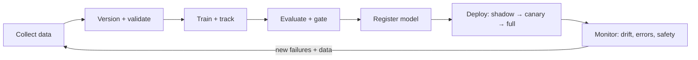

# MLOps and Data Engineering

:::tip[The 30-second version]
A model is only useful if it can be **trained repeatedly, deployed safely, monitored and improved**. **MLOps** is the engineering around the model: versioned data, reproducible training, automated tests, deployment, monitoring and retraining. For robots add one twist: **the data pipeline is a fleet** (logs from many robots flow back to improve the model).
:::

## 1. The lifecycle

## 2. Data engineering

| Task | Practices |
|---|---|
| **Ingestion** | stream from devices/robots; record with timestamps and metadata (robot ID, software version, calibration) |
| **Storage formats** | **Parquet** (tabular), **MCAP** (robot logs), **HDF5/Zarr** (arrays), MP4 + Parquet (LeRobot datasets), object storage (S3/GCS) |
| **Validation** | schema checks, range checks, missing-data checks, duplicate detection |
| **Labelling** | manual tools (CVAT, Label Studio), model-assisted labelling (SAM, foundation models), active learning |
| **Versioning** | dataset versions by content hash or tag (DVC, Hugging Face Hub, lakeFS); never edit in place |
| **Splitting** | by group (scene, episode, robot, day) to avoid leakage |
| **Lineage and cards** | record source, licence, transformations; write data cards |
| **Privacy** | blur faces/plates, strip personal data, comply with consent and regulations |

**Robot-specific:** trigger-based logging (save clips around failures or uncertain predictions), on-device filtering to cut bandwidth, time-synchronised multi-sensor bundles, calibration versioning.

## 3. Experiment tracking and reproducibility

- Log config, seed, code commit, dataset version, metrics, system info (**Weights & Biases, MLflow, TensorBoard**).
- Pin environments (Docker, `uv.lock`, conda-lock); record GPU/driver versions.
- Store checkpoints and the best-by-validation model with metadata.
- Compare runs in tables; keep a results ledger.

## 4. Training infrastructure

| Component | Notes |
|---|---|
| **Compute** | local GPUs, cloud (spot instances), clusters (Slurm, Kubernetes) |
| **Orchestration** | pipelines (Airflow, Prefect, Kubeflow, Metaflow, GitHub Actions) |
| **Distributed training** | DDP, FSDP/ZeRO, `torchrun`, `accelerate` |
| **Checkpointing and resume** | save often; automatic restart after pre-emption |
| **Hyper-parameter search** | Optuna, Ray Tune with early stopping |
| **Cost control** | smoke tests, spot instances, mixed precision, caching datasets |

## 5. Evaluation gates and registries

- **Automated evaluation** on held-out and slice-based test sets after every training run.
- **Regression tests**: new model must not degrade on critical scenarios.
- **Promotion rules**: only models passing thresholds enter the **model registry** (MLflow Registry, W&B Registry, Hugging Face Hub).
- **Model cards**: intended use, data, metrics, limits.
- For robots: **simulation regression suites** and fixed real-world acceptance tests.

## 6. Deployment patterns

| Pattern | Idea |
|---|---|
| **Shadow mode** | new model runs alongside the live one without acting; compare outputs |
| **Canary release** | send a small fraction of traffic/robots to the new model first |
| **A/B test** | compare two versions on live metrics |
| **Blue/green** | switch between two full deployments with instant rollback |
| **OTA updates** | signed, staged, rollback-capable updates for robot fleets |

**Serving options:** REST/gRPC services (vLLM, Triton, TorchServe, FastAPI), embedded runtimes (TensorRT, ONNX Runtime), on-device apps.

**Optimisation:** quantisation, pruning, distillation, batching, caching, compiling (`torch.compile`, TensorRT).

## 7. Monitoring and feedback

| What to monitor | Why |
|---|---|
| **Input drift** | data distribution changed (new lighting, new site) |
| **Prediction drift and confidence** | model behaving differently |
| **Performance on labelled samples** | true quality (delayed labels) |
| **Latency, throughput, errors, resource use** | operational health |
| **Safety events and interventions** | robot-specific: e-stops, human takeovers, near misses |
| **Data quality** | sensor failures, missing streams |

Close the loop: failures and takeovers become **new training data**; schedule retraining; keep human review for labels and safety-critical decisions.

## 8. CI/CD for ML and robotics

- **On every change:** lint, unit tests, small training smoke test, config validation.
- **Nightly:** full evaluation, simulation regression, performance benchmarks.
- **Release:** build container, run acceptance tests, sign artefacts, deploy gradually, monitor.
- **Infrastructure as code** (Terraform, Helm) for repeatable environments.

## 9. Common failure modes

| Failure | Prevention |
|---|---|
| Training/serving skew (different preprocessing) | share preprocessing code; test with golden inputs |
| Silent data corruption | validation and checksums |
| Un-reproducible results | config + seed + data/code versions logged |
| Slow rollbacks | keep the previous model ready; automate rollback |
| Alert fatigue | alert on actionable metrics only |
| Forgotten feedback loop | schedule failure review and data collection |

## Interview Q&A

**What is training/serving skew?**
*Simply:* the model sees differently processed data in production than in training. *Deeper:* fix by sharing code and logging production inputs.

**Shadow versus canary deployment?**
*Simply:* shadow runs without acting; canary acts for a small share. *Deeper:* use shadow first for safety-critical systems.

**How do you detect model drift?**
*Simply:* compare production input and output distributions with training ones. *Deeper:* statistical tests (PSI, KS), monitoring confidence, and periodically labelled samples.

**How do you version a dataset?**
*Simply:* by content hash or tag, never overwritten. *Deeper:* DVC/Hub/lakeFS with data cards and lineage.

**What belongs in a model card?**
*Simply:* purpose, data, metrics, limits. *Deeper:* slice performance, ethical considerations, version and contact.

**How would you set up a data flywheel for a robot fleet?**
*Simply:* log failures and takeovers, label them, retrain, test, roll out gradually. *Deeper:* trigger-based logging, evaluation gates and a staged OTA process.
