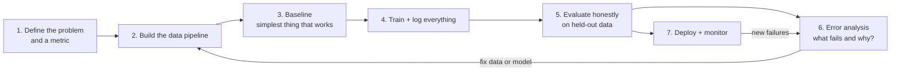

# Build It Yourself: AI model → VLM → VLA

:::tip[The 30-second version]
This section is a **hands-on build manual**. You will build three things, each reusing the last:
1. **An AI model** (a small GPT from scratch, then fine-tuning a real LLM), to learn the full loop of data → training → evaluation → deployment.
2. **A VLM** (a model that sees and talks): vision encoder + connector + LLM, trained in two stages.
3. **A VLA** (a model that sees, reads and *acts*): a VLM plus an action head, trained on robot demonstrations.

Every chapter has (a) a step-by-step plan, (b) code that actually runs, (c) recommended settings, (d) what to check at each step, and (e) the mistakes that waste weeks.
:::

*Follow the chapters in order. The skills carry over: a VLA is "a VLM plus an action head", and a VLM is "an LLM plus eyes".*

## What you need

### Knowledge (read these first if a word is new)
| Need | Where in this Bible |
|---|---|
| Gradient descent, loss, overfitting | [Math](../01-foundations/linear-algebra-probability.md), [ML](../02-machine-learning/ml-fundamentals.md) |
| Neural nets, transformers, attention | [DL fundamentals](../03-deep-learning/dl-fundamentals.md), [Architectures](../03-deep-learning/architectures.md) |
| LLM / VLM / VLA concepts | [LLM](../05-foundation-models/llm.md), [VLM & VLA](../05-foundation-models/vlm-vla.md) |
| Imitation learning and robot data | [Imitation learning](../07-physical-ai/imitation-robot-learning.md) |

### Software stack
| Layer | Tools |
|---|---|
| Language / framework | Python 3.10+, **PyTorch** |
| Model zoo and training helpers | **Hugging Face** `transformers`, `datasets`, `peft` (LoRA), `trl` (SFT/DPO), `accelerate` |
| Robot learning | **LeRobot** (datasets, ACT, Diffusion Policy, SmolVLA, π0), `openpi` (π0 / π0.5), Isaac Lab / GR00T for humanoids |
| Serving | **vLLM** / SGLang (LLMs, VLMs), TensorRT / ONNX (edge), `llama.cpp` (CPU / small devices) |
| Experiment tracking | **Weights & Biases** or TensorBoard, `git` for code, DVC or HF Hub for data and checkpoints |
| Environment | `uv` or `conda`, Docker for reproducibility |

### Hardware and budget (rule-of-thumb numbers)

| Goal | Minimum hardware | Typical time |
|---|---|---|
| Run the **three tiny scripts** in this section | any laptop CPU | minutes |
| LoRA fine-tune a 0.5–3 B-parameter LLM | one 16–24 GB GPU | hours |
| QLoRA fine-tune a 7 B LLM | one 24 GB GPU | hours to a day |
| Fine-tune a small VLM (SmolVLM, Qwen2-VL-2B) | one 24–48 GB GPU | hours |
| Build a LLaVA-style 7 B VLM from parts (both stages, full-size data) | 8 × 80 GB GPUs | roughly a day |
| Train **ACT** or **Diffusion Policy** on your robot data | one 8–16 GB GPU | hours |
| Fine-tune **SmolVLA** (≈ 450 M) | one 16–24 GB GPU | hours |
| LoRA fine-tune **π0** (≈ 3 B) | one ≈ 24 GB+ GPU (full fine-tune needs 70 GB+) | hours to a day |
| Real robot (low-cost arm, e.g. SO-100 / SO-101 with leader + follower) | a few hundred dollars of parts + 2 USB cameras | days to assemble and calibrate |

*These figures are approximate and move with software versions; check each project's README for current requirements. Cloud GPUs (A100/H100) are rented by the hour and are usually the cheapest way to try large jobs.*

## The universal build loop

Every model in this section is built with the same loop. Memorise it:

**Golden rules (they save weeks):**
1. **Make a tiny version work end to end first** (tiny data, tiny model, one minute of training), *then* scale.
2. **Overfit one small batch** on purpose. If the model can't memorise 16 examples, there is a bug.
3. **Look at your data** (print samples, view images, play episodes) before training.
4. **Change one thing at a time**, and log every run (config, seed, code version, data version).
5. **Hold out a test set you never tune on.** For robots: hold out *scenes and objects*, not just frames.
6. **Measure the right thing.** Loss going down is not the goal; task success is.

## The plan (8–12 weeks, part-time)

| Week | Do | Done when |
|---|---|---|
| 1 | Environment set-up; run `01_tiny_gpt.py`; read the training-loop code line by line | you can explain each line |
| 2 | Fine-tune a small LLM with LoRA on your own text/task | evaluation beats the base model |
| 3 | Run `02_tiny_vlm.py`; understand token flow and loss masking | you can predict what happens if you freeze the encoder |
| 4 | Fine-tune a real small VLM (SmolVLM / Qwen2-VL) on a custom image-question dataset | measurable accuracy gain on a held-out set |
| 5 | Run `03_tiny_vla.py` with both heads; compare BC and flow matching | closed-loop success > 90 % |
| 6 | Set up simulation (LIBERO or Isaac Lab) **or** the real arm; collect 50 demos | data replays correctly |
| 7 | Train ACT; evaluate with ≥ 30 trials | you have a baseline success rate with confidence interval |
| 8 | Train SmolVLA / π0 with language; compare with ACT | clear table of results |
| 9–12 | Failure analysis → collect targeted data → retrain; deploy with safety layer | success rate improves per iteration |

## How the files in this section fit together

| Page | You build | Code |
|---|---|---|
| [1. Build an AI model](./01-build-an-ai-model.md) | tiny GPT, then a fine-tuned LLM | `examples/01_tiny_gpt.py` |
| [2. Build a VLM](./02-build-a-vlm.md) | tiny VLM, then a real VLM | `examples/02_tiny_vlm.py` |
| [3. Build a VLA](./03-build-a-vla.md) | tiny VLA, then a real robot policy | `examples/03_tiny_vla.py` |
| [4. Evaluate, deploy, debug](./04-evaluate-deploy-debug.md) | the shared toolkit | checklists |

The three example scripts live in the repository's `examples/` folder, and **the complete source is also printed inside each chapter**, so you can copy it straight from this page.
