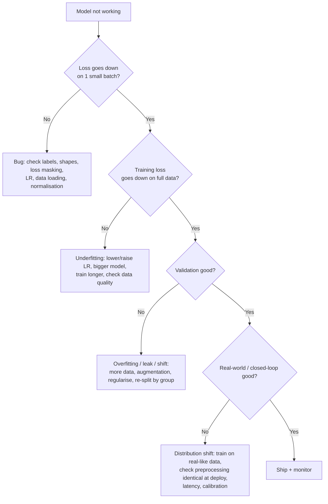

# 4. Evaluate, Deploy and Debug

:::tip[The 30-second version]
Most failed AI projects don't fail in the model; they fail in **evaluation** (fooling yourself), **data** (leaks, bad labels) and **deployment** (the lab setup isn't the real one). This chapter is the checklist you run for *every* model in this section: LLM, VLM and VLA.
:::

## 1. Experiment hygiene (do this from day one)

| Practice | How |
|---|---|
| **One config per run** | a YAML/dataclass with every hyper-parameter; save it with the checkpoint |
| **Seeds** | set Python/NumPy/PyTorch seeds; report mean ± std over ≥ 3 seeds for important claims |
| **Track runs** | Weights & Biases or TensorBoard: loss curves, learning rate, grad-norm, samples, system metrics |
| **Version data** | content hash or version tag in the config; never edit a dataset in place |
| **Version code** | log the git commit; keep the working tree clean when you train |
| **Checkpoints** | save every N steps + the best by *validation* metric; keep optimizer state to resume |
| **Reproduce in a fresh environment** | Docker or pinned `requirements.txt`/`uv.lock` |

## 2. Evaluation: how not to fool yourself


*Pick the checkpoint by validation, report once on the untouched test set.*

1. **Three splits** (train / validation / test). Tune on validation; touch test **once**.
2. **Split by group** (document, user, scene, episode, object). Random frame-level splits leak near-duplicates.
3. **Baselines.** Always compare with (a) a trivial baseline, (b) a pretrained/zero-shot model, (c) your previous best.
4. **Confidence intervals.** For success rates use the Wilson interval; 18/20 successes is "70–97 %", not "90 %".
5. **Slice the metric.** Report by condition (lighting, object type, language phrasing), not just the average.
6. **Error analysis.** Read 50–100 failures; tag the cause; the largest tag is your next experiment.
7. **Ablations.** Remove one component at a time to show what matters.
8. **Sanity checks.** Shuffled labels should give chance accuracy; a blank image should change a VLM's answer; a robot policy given the wrong instruction should fail.

```python
import math
def wilson(successes, n, z=1.96):                  # 95% confidence interval for a success rate
    p = successes / n
    centre = (p + z * z / (2 * n)) / (1 + z * z / n)
    half = z * math.sqrt(p * (1 - p) / n + z * z / (4 * n * n)) / (1 + z * z / n)
    return centre - half, centre + half
print(wilson(18, 20))                              # about (0.70, 0.97)
```

### Metrics cheat sheet
| Model | Primary metrics |
|---|---|
| LLM | task accuracy / exact match, pass@k (code), win-rate vs a baseline, perplexity (pre-training only), human/LLM-judge rubric |
| VLM | VQA accuracy, POPE (hallucination), OCR benchmarks, grounding accuracy, your domain set |
| VLA / policy | **success rate** (with CI), time-to-complete, number of interventions, collision/force-limit violations, generalisation splits (new object / position / lighting / phrasing) |

## 3. Deployment

| Target | Stack | Key actions |
|---|---|---|
| **Cloud API (LLM / VLM)** | vLLM / SGLang / TGI behind an HTTP server | quantise, batch, set `max_model_len`, autoscale, log requests |
| **Edge GPU (robot)** | TensorRT / TensorRT-LLM / ONNX Runtime on Jetson | export, FP16/INT8, benchmark latency, pin clocks (`nvpmodel`, `jetson_clocks`) |
| **CPU / small devices** | `llama.cpp` (GGUF), MLC | 4-bit quantisation |
| **Robot control** | ROS 2 node or LeRobot loop | async inference, safety layer, watchdog (see the VLA chapter) |

**Latency budget:** write the end-to-end budget (camera → preprocess → inference → postprocess → motor) and measure each part. Inference must be faster than your chunk execution time.

**Before every deployment:** re-run evaluation *after* quantisation/export; test on the real hardware or real traffic in **shadow mode** (model runs but doesn't act); roll out gradually; keep a rollback.

## 4. Debugging flowchart



### Top bugs, in order of how often they appear
1. **Train/deploy preprocessing mismatch** (different image size, colour order RGB/BGR, normalisation stats, action scaling).
2. **Wrong labels/masks** (shifted targets, masked everything, training on prompts).
3. **Data leakage** (near-duplicates across splits).
4. **Index/order mismatches** (joint order, camera order, class ids).
5. **Learning-rate problems** (too high → NaN/instability; too low → nothing happens).
6. **Forgetting `model.eval()` / `torch.no_grad()`** at evaluation.
7. **Latency or timing** (stale camera frames, fps mismatch, actions executed late).

## 5. Compute and cost planning

| Step | Formula / rule |
|---|---|
| **Training FLOPs** | $\approx 6 \times N \times D$ (parameters × tokens) |
| **GPU time** | FLOPs ÷ (GPU peak × utilisation, usually 30–50 %) |
| **Memory (bf16 training, Adam)** | ≈ 16–20 bytes per parameter for full fine-tuning (weights + grads + optimizer), far less with LoRA |
| **Inference memory** | ≈ 2 bytes/parameter (bf16), 1 (int8), 0.5 (int4), plus KV cache |
| **Cost** | GPU-hours × hourly price; always run a 5-minute smoke test before a long job |

## 6. Master checklists

**Before you train**
- [ ] I can state the task and the metric in one sentence.
- [ ] I looked at 50 random training examples.
- [ ] Splits are by group; no leakage.
- [ ] I have a baseline number.
- [ ] A tiny run overfits one batch.
- [ ] Config, seed, data version and code commit are logged.

**Before you evaluate**
- [ ] Checkpoint chosen on validation only.
- [ ] Test set untouched until now.
- [ ] Reporting confidence intervals and slices.

**Before you deploy**
- [ ] Re-evaluated after quantisation/export.
- [ ] Preprocessing is byte-for-byte the same as training.
- [ ] Latency measured on target hardware.
- [ ] Shadow-mode or sandbox test passed.
- [ ] Monitoring and rollback exist.

**Before a robot moves (extra)**
- [ ] Joint limits, velocity limits and workspace box enforced *outside* the model.
- [ ] Emergency stop within reach; a person watching the first runs.
- [ ] Low speed / low torque for the first trials.
- [ ] Every run is logged (video + actions) for failure analysis.
